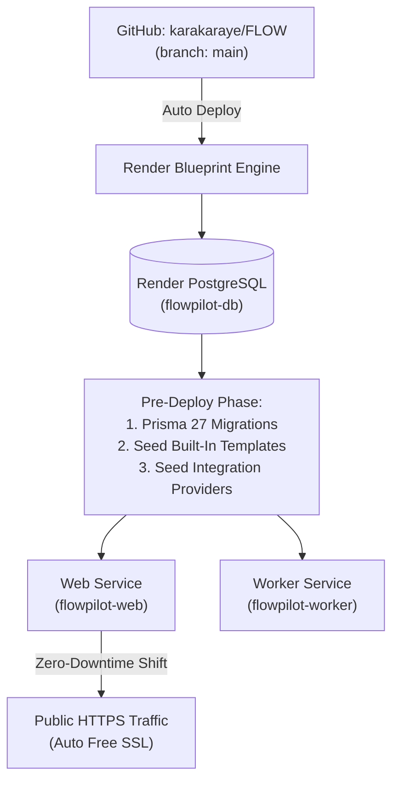

# FlowPilot AI: Render 1-Click Deployment Guide

This guide walks you through deploying **FlowPilot AI** to [Render](https://render.com) using the included `render.yaml` Blueprint specification.

---

## 1. Prerequisites

1. A [Render Account](https://render.com).
2. Your GitHub repository connected to Render: `https://github.com/karakaraye/FLOW`.
3. (Optional) A [Resend](https://resend.com) API key for transactional email delivery (`re_...`).

---

## 2. One-Click Blueprint Deployment

Deploying FlowPilot AI to Render takes less than 2 minutes using Render's Blueprint engine:

1. Log into your [Render Dashboard](https://dashboard.render.com).
2. Click **New +** in the top right corner and select **Blueprint**.
3. Connect your repository: **`karakaraye/FLOW`** (select branch `main`).
4. Render will automatically parse `render.yaml` and discover:
   * **`flowpilot-web`**: The Next.js 16 App Router web application.
   * **`flowpilot-worker`**: The background task queue worker.
   * **`flowpilot-db`**: The managed PostgreSQL database.
5. In the configuration prompt:
   * **`RESEND_API_KEY`**: *(Optional)* Enter your Resend key (`re_...`) or leave blank to use the secure console logger.
   * **`BETTER_AUTH_URL`**: Leave blank to use your default `https://<app>.onrender.com` URL, or enter your custom domain (e.g., `https://flowpilot.yourcompany.com`).
6. Click **Apply**.

---

## 3. What Render Does Automatically

Render orchestrates the entire deployment pipeline with zero manual intervention:



1. **Database Provisioning**: Render creates `flowpilot-db` with PostgreSQL 16/17 and generates private, encrypted connection strings.
2. **Pre-Deploy Execution**: Before starting the web service, Render runs:
   ```bash
   npx prisma migrate deploy && node --import tsx scripts/seed-templates.ts && node --import tsx scripts/seed-providers.ts
   ```
   All 27 database schema migrations and starter templates are deployed cleanly.
3. **Container Compilation**: The multi-stage Docker build compiles Next.js 16 using Turbopack with zero warnings.
4. **Health Check Verification**: Render tests `/api/health/live` to ensure the web service is fully responsive before directing live internet traffic to it.
5. **Worker Launch**: The background worker boots with a graceful 180-second SIGTERM drain period.

---

## 4. Custom Domain & DNS (Optional)

If you want to use your own custom domain (e.g. `app.yourcompany.com`):

1. In the Render Dashboard, open **flowpilot-web** -> **Settings** -> **Custom Domains**.
2. Add your domain (e.g. `app.yourcompany.com`).
3. Add the `CNAME` record in your DNS provider pointing to Render's specified target.
4. Render automatically provisions a free Let's Encrypt SSL certificate.
5. In **flowpilot-web** -> **Environment**, update `BETTER_AUTH_URL` to your custom domain:  
   `BETTER_AUTH_URL=https://app.yourcompany.com`

---

## 5. Live Maintenance & Updates

* **Automated CI/CD**: Every push to `main` on `https://github.com/karakaraye/FLOW` triggers an automated zero-downtime re-deployment on Render.
* **Database Backups**: Render automatically takes daily backups of `flowpilot-db` retained for 7 days.
* **Logs & Metrics**: View real-time web and worker execution logs directly in the Render web dashboard.
